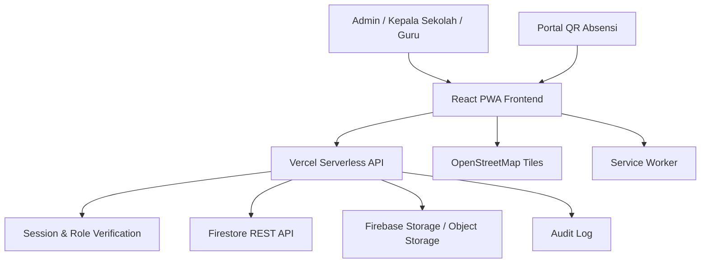

# BLUEPRINT TEKNIS
# ABSENSI SEKOLAH — MI MIFTAHUL ULUM SUMBERWULUH

**Versi:** 1.0  
**Arsitektur:** React/Vite + Vercel API + Firestore REST API  
**Cakupan:** Satu sekolah, tiga dashboard terpisah

---

## 1. Gambaran Arsitektur



Frontend tidak mengakses koleksi privat Firestore secara langsung. Semua operasi yang membutuhkan identitas dan hak akses melalui API server.

## 2. Struktur Aplikasi

```text
absensi-sekolah/
├── public/
│   ├── icons/
│   ├── manifest.webmanifest
│   ├── favicon.ico
│   └── service-worker.js
├── src/
│   ├── app/
│   │   ├── router/
│   │   ├── providers/
│   │   └── guards/
│   ├── components/
│   │   ├── layout/
│   │   ├── tables/
│   │   ├── forms/
│   │   ├── qr/
│   │   ├── maps/
│   │   └── charts/
│   ├── features/
│   │   ├── auth/
│   │   ├── admin-dashboard/
│   │   ├── principal-dashboard/
│   │   ├── teacher-dashboard/
│   │   ├── students/
│   │   ├── teachers/
│   │   ├── classes/
│   │   ├── schedules/
│   │   ├── attendance/
│   │   ├── portal/
│   │   ├── geofencing/
│   │   ├── permissions/
│   │   ├── qr-cards/
│   │   ├── reports/
│   │   ├── settings/
│   │   └── audit/
│   ├── lib/
│   ├── services/
│   ├── hooks/
│   ├── types/
│   └── styles/
├── api/
│   ├── auth/
│   ├── students/
│   ├── teachers/
│   ├── classes/
│   ├── schedules/
│   ├── attendance/
│   ├── permissions/
│   ├── reports/
│   ├── uploads/
│   └── admin/
├── tests/
└── vercel.json
```

## 3. Peta Navigasi

### 3.1 Admin
- Dashboard
- Master Data
  - Data Siswa
  - Data Guru
  - Data Kelas
  - Mata Pelajaran
  - Tahun Ajaran
- Manajemen Absensi
  - Portal Absensi
  - Data Kehadiran
  - Aturan Jam Absensi
  - Lokasi & Geofencing
- Akademik
  - Jadwal Mengajar
- Kartu & QR Code
- Perizinan
- Rekap & Laporan
- Pengguna & Hak Akses
- Log Aktivitas
- Pengaturan

### 3.2 Kepala Sekolah
- Dashboard
- Monitoring Kehadiran
- Rekap Siswa
- Rekap Guru
- Persetujuan Perizinan
- Laporan
- Riwayat Persetujuan
- Profil

### 3.3 Guru
- Dashboard
- Absensi Saya
- Jadwal Mengajar
- Riwayat Absensi
- Pengajuan Izin
- Profil & Password

### 3.4 Portal Absensi
- Jam/tanggal
- Pilih mode masuk/pulang atau mode otomatis berdasarkan jadwal
- Kamera QR
- Input scanner USB
- Status GPS
- Hasil scan
- Voice announcement
- Tombol keluar dengan password portal

## 4. Alur Utama

### 4.1 Login
1. Pengguna mengisi username dan password.
2. Frontend mengirim HTTPS request ke `/api/auth/login`.
3. Server menerapkan rate limit dan memverifikasi password hash.
4. Server membuat sesi acak dan menyimpan hash token sesi.
5. Browser menerima cookie `HttpOnly`, `Secure`, `SameSite`.
6. Server mengembalikan profil minimum dan role.
7. Router mengarahkan ke dashboard sesuai role.

Logout mencabut sesi di server. Cookie tidak menjadi satu-satunya sumber otorisasi; setiap API memeriksa sesi aktif.

### 4.2 Scan QR Siswa
1. Scanner membaca token QR.
2. Frontend meminta lokasi jika GPS diaktifkan.
3. Frontend mengirim token QR, jenis absensi, koordinat, akurasi, dan idempotency key ke API.
4. Server memvalidasi sesi portal/perangkat, token QR, status siswa, aturan waktu, dan lokasi.
5. Server membuat catatan absensi dengan waktu server.
6. Server mengembalikan hasil.
7. UI menampilkan nama/status dan memainkan suara sesuai template.

### 4.3 Absensi Guru Mandiri
1. Guru login.
2. Guru membuka menu Absensi Saya.
3. Browser meminta izin kamera dan lokasi.
4. Guru mengambil selfie.
5. Frontend mengunggah foto melalui endpoint aman.
6. Frontend mengirim metadata dan referensi foto ke endpoint absensi.
7. Server memvalidasi akun, waktu, GPS, geofence, dan duplikasi.
8. Hasil tersimpan dan muncul pada dashboard.

### 4.4 Perizinan
1. Guru mengajukan izin.
2. Status `SUBMITTED`.
3. Admin meninjau dan memberi verifikasi/rekomendasi.
4. Status `ADMIN_REVIEWED` atau `RETURNED`.
5. Kepala Sekolah menyetujui/menolak.
6. Status akhir `APPROVED` atau `REJECTED`.
7. Setiap transisi masuk audit log.

## 5. Matriks Hak Akses

| Modul | Admin | Kepala Sekolah | Guru |
|---|---:|---:|---:|
| Dashboard | Kelola/lihat | Lihat | Pribadi |
| Master siswa | CRUD | Lihat | Tidak |
| Master guru | CRUD | Lihat | Profil sendiri |
| Kelas | CRUD | Lihat | Jadwal terkait |
| Jadwal mengajar | CRUD | Lihat | Jadwal sendiri |
| Portal QR | Kelola | Lihat status | Tidak |
| Absensi siswa | Kelola/koreksi | Lihat | Tidak |
| Absensi guru | Kelola/koreksi | Lihat | Milik sendiri |
| Izin | Verifikasi | Keputusan akhir | Ajukan/lihat sendiri |
| Laporan | Semua | Semua sesuai sekolah | Riwayat sendiri |
| Pengaturan | Kelola | Tidak/terbatas | Profil sendiri |
| Audit log | Lihat | Lihat terbatas | Tidak |

Semua otorisasi diperiksa pada API, bukan sekadar berdasarkan menu frontend.

## 6. Desain API

Semua endpoint menggunakan HTTPS dan JSON kecuali upload.

### Auth
- `POST /api/auth/login`
- `POST /api/auth/logout`
- `GET /api/auth/me`
- `POST /api/auth/change-password`
- `POST /api/auth/reset-password` (admin terotorisasi)

### Master data
- `GET/POST /api/students`
- `GET/PATCH/DELETE /api/students/:id`
- `POST /api/students/import`
- `GET/POST /api/teachers`
- `GET/PATCH/DELETE /api/teachers/:id`
- `GET/POST /api/classes`
- `GET/POST /api/subjects`
- `GET/POST /api/academic-years`

### Jadwal
- `GET/POST /api/schedules`
- `GET/PATCH/DELETE /api/schedules/:id`
- `GET /api/teachers/me/schedule`

### Absensi
- `POST /api/attendance/scan`
- `POST /api/attendance/teacher-self`
- `GET /api/attendance`
- `GET /api/attendance/:id`
- `PATCH /api/attendance/:id/correction`
- `GET /api/attendance/me`

### Izin
- `POST /api/permissions`
- `GET /api/permissions`
- `POST /api/permissions/:id/admin-review`
- `POST /api/permissions/:id/decision`
- `GET /api/permissions/me`

### QR, upload, laporan
- `POST /api/qr/tokens`
- `POST /api/qr/revoke`
- `POST /api/uploads/presign` atau endpoint upload tervalidasi
- `GET /api/reports/attendance`
- `POST /api/reports/export`

### Pengaturan dan audit
- `GET/PATCH /api/settings`
- `GET /api/audit-logs`

Gunakan paginasi cursor, validasi schema, batas ukuran request, dan idempotency key untuk operasi absensi.

## 7. Validasi Geofencing

Server menghitung jarak antara koordinat sekolah dan koordinat perangkat menggunakan rumus Haversine.

Absensi lolos jika:
- Koordinat valid.
- Akurasi GPS tidak melebihi batas yang dikonfigurasi.
- Jarak berada dalam radius yang ditetapkan.
- Aturan lokasi berlaku untuk jenis pengguna tersebut.

Catatan: lokasi browser dapat dimanipulasi pada perangkat tertentu. Jangan menganggap GPS browser sebagai anti-spoofing sempurna. Simpan akurasi, jarak, dan indikator risiko.

## 8. PWA

- `manifest.webmanifest` dengan `display: standalone`.
- Icon 192, 512, maskable, favicon.
- Service worker untuk aset aplikasi.
- Offline fallback.
- Jangan cache response API sensitif, foto selfie, token QR, atau data pribadi.
- Uji instalasi Android Chrome dan desktop.

WebAPK dibuat/dikelola oleh browser Android yang mendukung PWA; proyek Vercel hanya menyediakan PWA yang memenuhi persyaratan instalasi.

## 9. Rencana Pengujian

- Unit test: aturan jam, status, jarak geofence, role.
- API test: autentikasi, akses tanpa sesi, akses lintas role.
- Integration test: scan QR, upload selfie, izin, ekspor.
- UI test: login dan navigasi tiga dashboard.
- Security test: rate limit, IDOR, mass assignment, upload berbahaya, session expiry.
- Device test: kamera depan/belakang, scanner USB, GPS, izin browser.
- PWA test: install, standalone, update service worker.

## 10. Deployment

1. Buat Firebase project dan Firestore.
2. Konfigurasi Storage bila digunakan.
3. Siapkan service account khusus dengan hak minimum.
4. Simpan credential hanya pada Vercel Environment Variables.
5. Implementasi Firestore REST API dari Vercel Functions; jangan memakai Firebase Admin SDK.
6. Set environment variable per environment.
7. Deploy preview.
8. Jalankan migrasi/seed awal.
9. Uji role dan security.
10. Deploy production dengan domain HTTPS.
11. Uji instalasi PWA.

---
**Akhir Blueprint**
